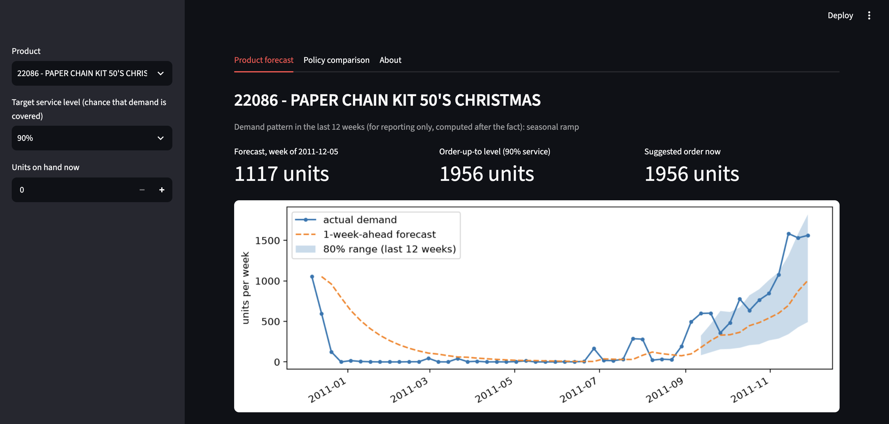
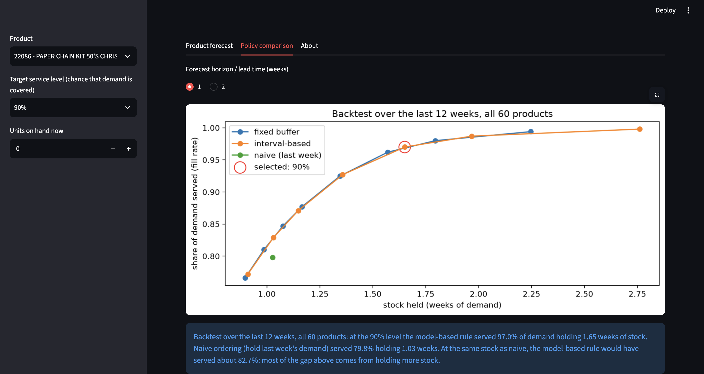

# Retail Demand Forecasting & Inventory Optimizer

Forecasts weekly demand for 60 retail products, builds prediction ranges from past forecast errors, and turns them into order-up-to recommendations. A weekly inventory simulation compares ordering policies, and a Streamlit dashboard shows the results.

**Live demo:** _add the Streamlit link here after deployment_




## Problem
Retailers lose money in two ways: stockouts (lost sales) and overstock (cash locked in unsold goods). Most small retailers order by intuition. This project asks how much a forecast-based ordering rule improves on simple ordering, and how reliable the uncertainty ranges are.

## Data
UCI Online Retail dataset: 541,909 transactions from a UK online wholesaler, 1 Dec 2010 to 9 Dec 2011, 4,070 products. After cleaning: 495,525 rows, 3,882 products, 52 full weeks (6 Dec 2010 to 4 Dec 2011). The analysis uses the 60 products with the most orders among those sold in at least 40 of the 52 weeks.

## Approach
1. **Cleaning** (`02_cleaning`): cancelled invoices moved to a separate returns table (demand means purchases only); removed stock adjustments, non-product codes (postage, fees) and 5,221 duplicates; trimmed to 52 full weeks; kept rows with missing CustomerID because demand does not depend on who bought.
2. **Weekly demand table** (`03_weekly_demand`): weekly units per product; missing weeks filled with zero. Products ranked by number of orders rather than units, so that a few bulk orders do not dominate the selection (38 of 60 products overlap with the units ranking). Single order lines of 1,900 to 4,300 units made up over 90% of some product-weeks, so order lines are capped per product (maximum of the 99th percentile and 10 times the median line size). This removes 10.0% of units; both actual and capped demand are kept, and models forecast the capped demand.
3. **EDA** (`04_eda`): 45 products are stable, 9 are seasonal ramps (demand more than doubled in the last 12 weeks) and 6 are intermittent (5 or more zero weeks). These labels are computed after the fact and used only for reporting, never as model inputs.
4. **Validation** (`05_baselines`): test period is the last 12 weeks (12 Sep to 28 Nov 2011); forecast horizons of 1 and 2 weeks stand in for supplier lead time; a forecast for week t uses only data up to week t minus the horizon. Metrics are MAE and WAPE (MAPE is avoided because of zero-demand weeks).
5. **Models** (`06_model`): naive, 4-week moving average, a pooled gradient-boosting model (scale-free lag features, refit for every test week), and an exponentially weighted moving average (EWMA) whose smoothing level was chosen on the 12 weeks before the test period.
6. **Prediction ranges** (`06_model`): 80% ranges from the 10th and 90th percentiles of recent relative forecast errors (8-week calibration window), using only errors already known at forecast time.
7. **Inventory simulation** (`07_optimizer`): over the 12 test weeks, each policy sets a stock level per product, real demand arrives, and unsold stock carries over. Policies are compared on fill rate, share of product-weeks short, and stock held.

## Results

### Forecast accuracy (WAPE, lower is better; test period 12 Sep to 28 Nov 2011)

| Method | All, 1-week | All, 2-week | Stable (45) | Intermittent (6) | Seasonal ramp (9) |
|---|---|---|---|---|---|
| Naive (last week) | 0.431 | 0.442 | 0.459 | 0.611 | 0.272 |
| 4-week moving average | 0.361 | 0.380 | 0.365 | 0.474 | 0.308 |
| Pooled gradient boosting | 0.368 | 0.390 | 0.357 | 0.462 | 0.370 |
| **EWMA (chosen)** | 0.365 | 0.383 | 0.353 | 0.447 | 0.373 |

Group columns are for the 1-week horizon. Every sensible method lands at a WAPE of about 0.36 to 0.37, and the test WAPE barely changes for smoothing levels between 0.2 and 0.5, so the remaining error is mostly weekly noise.

### Prediction ranges
Demand stayed at or below the upper end of the 80% range in 89.6% of product-weeks (target 90%): stable 92.8%, intermittent 84.7%, seasonal ramp 76.9%. Recent-window calibration kept coverage the same while making ranges about 6% narrower than calibrating on all past weeks.

### Inventory simulation (1-week lead time, 60 products, 12 weeks)

| Policy | Demand served | Product-weeks short | Stock held (weeks of demand) |
|---|---|---|---|
| Naive: hold last week's demand | 79.8% | 47.4% | 1.03 |
| Fixed buffer: EWMA forecast + 75% | 96.2% | 12.4% | 1.57 |
| Interval-based: 90th percentile of recent errors | 97.0% | 10.3% | 1.65 |

## Key findings
- **The forecast adds a modest gain over naive ordering.** The jump from 80% to 96-97% is mostly bought with about 55-60% more stock. At the same stock as naive (1.03 weeks), forecast-based ordering serves about 83% of demand (≈ +3 points), or needs about 6% less stock for the same 79.8% (≈ 0.96 weeks).
- **A pooled gradient-boosting model did not beat simple baselines** on one year of data. It also under-forecast more than the baselines (about 12% low overall and 32% low on ramping products at 1 week), consistent with trees being unable to predict above the range seen in training.
- **The interval-based rule is equivalent to a flat percentage buffer** at matched service (stock needed ≈ 1.25 vs 1.26 weeks for 90% fill, 1.50 vs 1.52 for 95%, 1.80 vs 1.84 for 98%), because pooled relative error quantiles are themselves a percentage margin.
- **Ramping products are the weak spot.** Ranges cover only 69-77% of their weeks (target 90%), and every miss is on the high side.

## Limitations
- One year of data and a test window that contains the pre-Christmas peak, which the models never saw in training; differences of about 0.01 WAPE are within noise.
- The 8-week calibration window and the choice of EWMA were made after looking at results; differences between options were small.
- The simulation assumes lost sales, leftover stock carried over, orders arriving in time, and no ordering or holding costs. It compares policies and is not a profit forecast.
- Bulk-order capping rules (99th percentile, 10 times the median) were not tuned.

## Ideas not yet tested
Per-product safety stock based on each product's own recent error, a cost-based optimizer with holding and stockout costs, and quantile gradient boosting for the ranges.

## Run it locally
```bash
git clone https://github.com/vaibhavgit23/Retail-demand-forecasting-optimizer-.git
cd Retail-demand-forecasting-optimizer-
python3 -m venv venv && source venv/bin/activate
pip install -r requirements-dev.txt
streamlit run app/app.py
```
`requirements-dev.txt` is the full environment used for the notebooks. `requirements.txt` lists only what the dashboard needs (streamlit, pandas, numpy, matplotlib), and is what the deployed app installs.

The dashboard reads the small files in `app/data/`, so it runs without the notebooks. To rebuild everything, download `Online Retail.xlsx` from the UCI Machine Learning Repository into `data/raw/` and run notebooks `01` to `07` in order.

## Project structure
```
app/            Streamlit dashboard (app.py) and its data (app/data/)
data/raw/       original download (not tracked)
data/processed/ files generated by the notebooks
docs/           dashboard screenshots
notebooks/      01 first look, 02 cleaning, 03 weekly demand, 04 EDA,
                05 baselines, 06 model and intervals, 07 optimizer
```

## Progress log
- Day 1: repo setup, data loaded, problem defined
- Day 2: cleaned data, separated returns, trimmed to 52 full weeks
- Day 3: built weekly demand table for the top 60 products; separated bulk orders (10% of units) from regular demand
- Day 4: exploratory analysis; 60 products split into stable (45), seasonal ramp (9) and intermittent (6)
- Day 5: validation design and baselines; best baseline (4-week moving average) WAPE 0.361 at 1-week horizon
- Day 6: pooled GBM vs baselines vs EWMA; all land at WAPE about 0.36-0.37; EWMA chosen as point forecast
- Day 7: 80% prediction intervals from past forecast errors (8-week calibration window); ramp products remain under-covered
- Day 8: inventory simulation; forecast + buffer vs naive ordering compared at matched stock/service
- Day 9: Streamlit dashboard with product forecast, order-up-to recommendation and policy comparison
- Day 10: polished dashboard, added screenshots, and rewrote README with results, key findings and limitations

## Data source
Online Retail dataset, UCI Machine Learning Repository (donated by Daqing Chen, 2015).